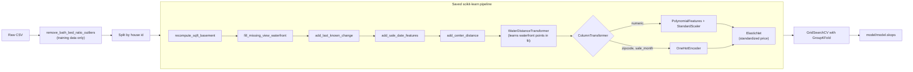

# ML Notebook Refactoring: King County House Prices

[](https://github.com/sean-mas/ml-notebook-refactoring/actions/workflows/tests.yml)

Built in the Spiced Academy AI Engineering bootcamp. The original notebook, the dataset and everything in [`course/`](course/) were provided by the course (© neuefische GmbH, MIT licence); everything else is the refactoring.

The [original notebook](King-County.ipynb) analyzes King County house sales and predicts sale prices, but all of its logic lives in notebook cells that mutate one global DataFrame. This project moves the data cleaning, feature engineering and modeling into a tested Python package with one reusable scikit-learn pipeline, adds a FastAPI CRUD service for houses in Docker, and fixes the bugs found along the way.

**Result:** the final pipeline explains **87.5%** of the price variance on unseen houses (test R² 0.875, split by house), against 84.4% in the original notebook. It runs in about 7 seconds and is covered by 33 pipeline tests and 15 API tests.

## Project Structure

| Path | What it is |
|---|---|
| [`King-County.ipynb`](King-County.ipynb) | The original notebook, unchanged |
| [`King-County-refactored.ipynb`](King-County-refactored.ipynb) | The refactored copy: same story and charts, but it only imports and calls functions from `src/` |
| [`src/king_county/config.py`](src/king_county/config.py) | Paths, reference coordinates, thresholds, feature lists, model settings |
| [`src/king_county/data_preparation.py`](src/king_county/data_preparation.py) | Loading and cleaning functions (DataFrame in, DataFrame out, copy-first) |
| [`src/king_county/feature_engineering.py`](src/king_county/feature_engineering.py) | Distances, price per square foot, sale date features |
| [`src/king_county/transformers.py`](src/king_county/transformers.py) | `WaterDistanceTransformer`, the one step that learns from training data |
| [`src/king_county/pipeline.py`](src/king_county/pipeline.py) | The reusable feature pipeline and model pipelines |
| [`src/king_county/modeling.py`](src/king_county/modeling.py) | Splits, baselines, grid search, error table, saving; runs as a script |
| [`src/king_county/plots.py`](src/king_county/plots.py) | Map helper for the notebook |
| [`tests/`](tests/) | Unit and integration tests for the pipeline |
| [`api/`](api/) | FastAPI CRUD app for houses with Postgres, Docker and API tests ([README](api/README.md)) |
| [`.github/workflows/tests.yml`](.github/workflows/tests.yml) | Runs both test suites and starts the API in Docker on every push and pull request |
| [`course/`](course/) | Material provided by the course: the brief, the grading checklist and the reference API ([README](course/README.md)) |

## The Pipeline



- The cleaning and feature functions are plain functions, so they are easy to test. The pipeline wraps them with `FunctionTransformer`.
- `WaterDistanceTransformer` is the only custom class, because it is the only step that has to remember something from training: the waterfront reference points.
- Removing implausible rows happens **before** the pipeline. A pipeline step cannot drop rows without breaking the pairing of features and prices, and when pricing a new house we never want to drop it.
- Because the saved pipeline includes all cleaning and feature steps, it accepts raw rows in the CSV's format and can price a single new house, even one with an unseen zipcode.

## How to Run

Requires [uv](https://docs.astral.sh/uv/) 0.13.5 or newer. It installs Python 3.13.17+ automatically.

```bash
uv sync
```

Train, compare all model versions and save the final model to `model/model.skops`:

```bash
uv run python -m src.king_county.modeling
```

Run the pipeline tests:

```bash
uv run pytest
```

Open [`King-County-refactored.ipynb`](King-County-refactored.ipynb) in VS Code, select the `.venv` kernel and run all cells. Its three maps are interactive Plotly charts, which GitHub's notebook preview cannot draw.

Run the API in Docker (host ports 8001 and 5433), then open <http://localhost:8001/docs>:

```bash
cd api && cp .env.example .env && docker compose up --build --wait
```

## Results

Each step adds one fix to the previous one, so the effect of every change is visible. `cv_r2` is the mean over 5 cross-validation folds on the training rows; `test_r2` is measured once on held-out houses.

| Version | Split | CV R² | Test R² |
|---|---|---|---|
| Original notebook (ElasticNet) | random | not reported | 0.844 |
| 1. Notebook model, bugs fixed, wider `alpha` grid | random | 0.840 | 0.852 |
| 2. + split by house id | by house | 0.844 | 0.837 |
| 3. + `zipcode` one-hot encoded | by house | 0.879 | 0.873 |
| 4. + sale year and month (**final**) | by house | 0.881 | **0.875** |

- **Encoding `zipcode` as a category** is the one big gain (+0.035 in both CV and test).
- **The split by house** removes a real leak (176 houses were sold twice), but only 1.6% of rows are affected, so the score barely changes beyond the noise of a different test sample.
- **The sale date** adds +0.002, which is within noise.

Linear baselines on the notebook's random split (adjusted R²):

| Model | Original notebook | Refactored |
|---|---|---|
| `grade` only | 0.43 | 0.448 |
| `grade` + `last_known_change` | 0.48 | 0.505 |
| All features with squared terms | 0.75 | **0.879** |

The squared-terms model improves because the pipeline now scales the features. On the notebook's exact rows and split, the unscaled version scores 0.76 and the scaled one 0.88: squared values such as `sqft_lot²` reach about 10¹², and numbers that far apart make the least-squares calculation lose precision. A plain linear regression on the final features scores about the same as the tuned ElasticNet (CV R² 0.886 vs. 0.881), so regularization adds little here; scaling and zipcode encoding are what made the difference.

## Problems Found in the Original Notebook

Cell numbers refer to [`King-County.ipynb`](King-County.ipynb), counted from 0.

**Wrong or misleading results**

| # | Cell | Problem | Fix |
|---|---|---|---|
| P1 | 55, 81, 91 | The text says the model predicts price per square foot; the code predicts `price` | Target stays `price`; text corrected |
| P2 | 56 | `sqft_price` divided by living **plus lot** area, while the text says living area | `add_price_per_sqft()` divides by living area; exploration only, never a model input (it contains the target) |
| P3 | 60, 67 | One reference point, two latitudes (47.62774 and 47.6219), and the distance formula written twice | One `distance_km()` and named constants |
| P4 | 28 | `drop(15856)` removes a row by its position, which breaks silently if the file changes | Rule-based `remove_bath_bed_ratio_outliers()` (the course's lesson-03 rule); removes the 33-bedroom house and 12 other implausible rows |
| P5 | 68 | Waterfront reference points came from all rows before the split, so test houses shaped training features, and new houses could not be scored | `WaterDistanceTransformer` learns them from training rows in `fit` and stores them in the saved pipeline |
| P6 | 114, 128 | Largest errors looked up by hardcoded house ids | `errors.nlargest(1, ...)` |
| P7 | various | Stale text: no code for the "missing values?" question, "2 bathrooms" for the 33-bedroom house (it has 1.75), "2.1 bathrooms per bedroom" (it is 2.1 bathrooms per house), "almost 19 km" to the water (its own output says 5.5 km), "83%" never computed, `sqft_above` missing from the data dictionary | Corrected in the refactored notebook, all numbers taken from a real run |

**Performance**

| # | Cell | Problem | Fix |
|---|---|---|---|
| P8 | 69 | Water distance in a nested Python loop: about 3.2 million calls, an estimated 23 seconds (timed on 100 houses) | One NumPy distance matrix: 0.02 seconds, identical values (regression test against the original loop) |
| P9 | 41 | Row-by-row loop with `str(x) == "nan"` | Vectorized `where()` |

**Structure**

| # | Problem | Fix |
|---|---|---|
| P10 | One global DataFrame changed in place across about 40 cells; pandas 3.1 also deprecates `inplace=` | Functions that copy their input and return a new DataFrame |
| P11 | Magic numbers (coordinates, 6378, 0.3, 42, grid values) | `config.py` |
| P12 | Copy-paste: adjusted R² ×3, error table ×2, map ×4, missing-value table ×2 | `adjusted_r2()`, `build_error_table()`, `plot_house_map()`, `missing_value_report()` |
| P13 | Helper columns `delta_lat`/`delta_long` stored and dropped later | Computed inside the function |
| P14 | Feature set implicit; `id` in `X`; column order only described in a comment | Explicit feature lists; the `ColumnTransformer` selects them by name |
| P15 | Imports in the middle of the notebook, string paths | Imports at the top, `pathlib` paths in `config.py` |
| P16 | Chained indexing like `kc_data["yr_built"][idx]` | Removed by vectorization |
| P17 | Unclear names (`kc_data`, `dist`, `yr_re`, `drop_lst`) | Names that say what they hold or do |

**Modeling**

| # | Problem | Fix |
|---|---|---|
| P18 | `zipcode` used as a number and even squared | One-hot encoded |
| P19 | 176 houses sold twice; a random split can put both sales on different sides | `GroupShuffleSplit` and `GroupKFold` by house id |
| P20 | Sale `date` dropped | `sale_year` and `sale_month` features |
| P21 | `sqft_above` always equals `sqft_living - sqft_basement`; the exact copy kept ElasticNet from converging | Dropped from the features; no score change, no warnings |
| P22 | Polynomial features not scaled before `LinearRegression` | `StandardScaler` in every model pipeline |
| P23 | The `alpha` grid's smallest value (0.01) always won, so the best value lay outside the grid | Grid extended to 0.001; lower values do not converge and gain less than 0.002 |

## Answers to the Project Questions (as submitted on 28.10.2026)

### What steps did you take to complete the project?

I started with a deep review of the notebook and listed everything that needed to change. From that I wrote a step-by-step plan and worked through it one step at a time, testing each step where I could.

The order was: record the original notebook's scores as a baseline, move cleaning and feature engineering into functions, wrap them in one scikit-learn pipeline, then add the modeling changes one at a time and measure each. Tests, the API and Docker came last.

### What challenges did you face?

Reading someone else's notebook is never intuitive for me. So I first skimmed the whole notebook to get the big picture, then went back and worked through each part in detail.

I knew from earlier work with this dataset that 176 houses were sold more than once. What surprised me was that the notebook missed it. It even counts the unique ids, which shows fewer ids than sales (21,420 for 21,597), and its data dictionary still calls `id` unique per sale. It then splits randomly, so the same house can land in both training and test. I split by house id instead, which gives a more honest score.

### What would you do differently if you had more time?

The goal of refactoring is that a team can work with the code. So I would ask a teammate to clone the repo and run it on their own computer. It works on my laptop, but only another person on another machine finds the setup problems I can't see.

I would also run the tests automatically on every pull request with GitHub Actions, the automated version of that check. And the brief only asks the API to store houses, so next I'd add a `/predict` endpoint that uses the trained model.
